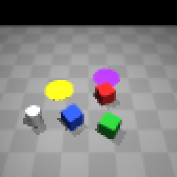

# Latent VLA

A small vision-language-action (VLA) model that controls a robot in MuJoCo from camera images, depth and a text command, using **continuous latent vectors instead of tokens**.

Given a command like *"push the red block to the yellow pad"*, the model looks at the scene and outputs the robot's next 16 moves.



## How it works

```
RGB image ─► CNN ─┐
Depth     ─► CNN ─┴─ add per patch ─► Perceiver pooling ─► 16 visual latents
Command   ─► word embeddings + transformer ─► pooling ───► 4 language latents
Pusher position ─► MLP ──────────────────────────────────► 1 latent
                              │
                              ▼
      transformer core (4 layers) + 16 learned action queries
                              │
                              ▼
          next 16 actions (continuous x/y moves, 10 Hz)
```

- **Task:** a table with 3 colored blocks (red, green, blue) and 2 colored pads (yellow, purple). A round pusher moving on the table plane must push the named block onto the named pad. The other blocks are distractors, so the model has to read the command.
- **Training data:** a scripted expert that knows the true block positions pushes blocks in thousands of randomized scenes. Noise is added to the moves it executes, but the clean move is stored as the label, so the model learns to recover from small mistakes.
- **Training:** behavior cloning. The model predicts the expert's next 16 actions (L1 loss).
- **Running:** the model predicts 16 actions, the robot executes the first 8, then the model looks again and re-plans.
- **Generalization test:** the combination "red block → purple pad" never appears in training. It checks whether the model composes "red" and "purple" or memorizes whole commands.

The full research plan (voice input, latent world model, robot arm) is in [plan.md](plan.md).

## Setup

Needs Python 3.10+ and PyTorch. A GPU helps (CUDA or Apple Silicon MPS); CPU works but is slow.

```bash
python3 -m venv --system-site-packages .venv
.venv/bin/pip install -r requirements.txt
```

`--system-site-packages` reuses an existing PyTorch install. Drop it if you want to install everything into the venv.

## Usage

All commands run from the project root.

### 1. Collect demonstrations

```bash
.venv/bin/python -m vla.collect --episodes 2000 --out data/push_v0
```

Runs the scripted expert in parallel processes and saves RGB, depth, positions, actions and commands into `data/push_v0/shard_*.npz`. Failed episodes are discarded.

- 2,000 episodes take about 1 minute and 2.8 GB of disk.
- Options: `--workers` (parallel processes, default 8), `--noise` (noise added to executed moves, default 0.25), `--seed`.

### 2. Train

```bash
# Sanity check: model sees true object positions instead of images (~14 min)
.venv/bin/python -m vla.train --obs state --out runs/state

# Main model: RGB + depth images (~27 min)
.venv/bin/python -m vla.train --obs rgbd --out runs/rgbd
```

Training prints train/validation loss every 500 steps, saves `model.pt`, then runs a quick evaluation in MuJoCo (120 episodes) and writes `train_log.json`.

- `--obs`: `rgbd` (images + depth), `rgb` (images only, to measure what depth adds) or `state` (true positions, no vision).
- Other options: `--steps` (default 12000), `--batch` (128), `--lr` (3e-4), `--horizon` (actions per prediction, 16), `--data`.

Times are for an Apple M3 Pro.

### 3. Evaluate

```bash
.venv/bin/python -m vla.evaluate --ckpt runs/rgbd/model.pt --episodes 240
```

Runs the model in MuJoCo on new random scenes, cycling through all 6 block/pad combinations including the held-out one. It prints success rates and saves:

- `runs/rgbd/eval.json`: success rates per command
- `runs/rgbd/gifs/`: videos of the first episodes (`--gifs N`, default 6), named by command and `ok`/`fail`

`--execute` sets how many of the 16 predicted actions run before re-planning (default 8).

## Results

Apple M3 Pro, 1,865 demos, 12k training steps:

| Model | Seen commands | Held-out (red → purple) |
|---|---|---|
| Scripted expert | 96.5% | — |
| True positions (`--obs state`) | 97% | 10% |
| RGB + depth (`--obs rgbd`), 240 episodes | 90% | 0% |

- The model learns to push blocks from images and follows the command on combinations it trained on.
- It fails on the held-out combination: instead of composing "red" and "purple", it mostly wanders. With only 5 training combinations, memorizing whole commands is easier than learning what each word means.
- Planned fixes: more colors and pads, a pretrained text encoder, and stronger language conditioning. See the next steps in [plan.md](plan.md).

## Code

| File | What it does |
|---|---|
| `vla/env.py` | MuJoCo scene, RGB-D rendering, random layouts, commands, success check |
| `vla/expert.py` | Scripted pushing controller (walks around the block, then pushes) |
| `vla/collect.py` | Parallel demo collection |
| `vla/dataset.py` | Loads demos, builds 16-step action chunks, random-shift image augmentation |
| `vla/text.py` | Word vocabulary for the commands |
| `vla/model.py` | The latent VLA model |
| `vla/train.py` | Training loop |
| `vla/evaluate.py` | Closed-loop evaluation and GIFs |

## Limitations

- The robot is a 2-DoF pusher, not an arm; there's no grasping yet.
- One fixed camera at 84×84 pixels.
- Commands come from 4 fixed templates. Words outside the vocabulary are ignored (mapped to an unknown token).
- No voice input yet.
